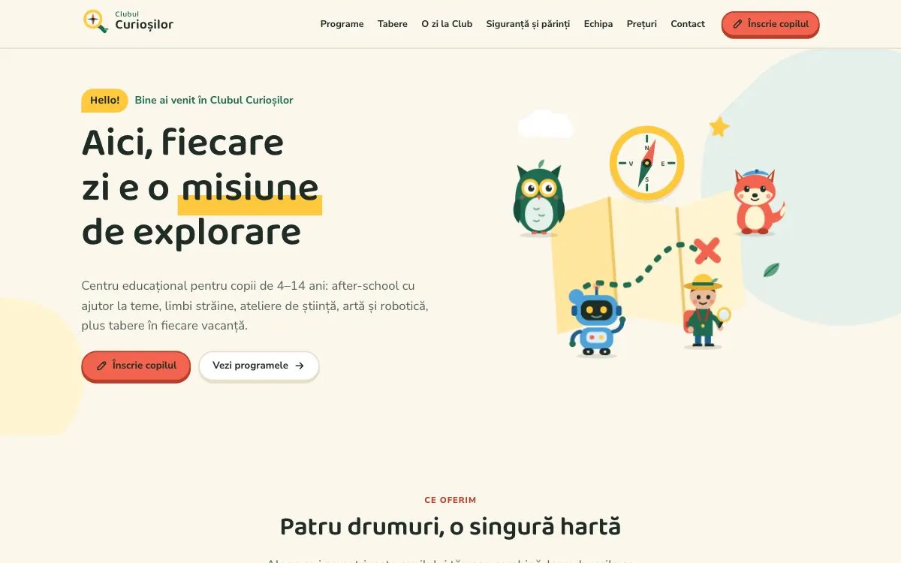

# Clubul Curioșilor

Site de prezentare și înscriere pentru un centru educațional pentru copii de 4–14 ani: after-school cu ajutor la teme, cursuri de limbi străine, ateliere (robotică, științe, arte, teatru, muzică, șah, sport, gătit) și tabere în vacanțe. Tema: curiozitate și explorare. Fiecare activitate e o „misiune”, fiecare grupă un „club de exploratori”.

**Live:** [manolacheioan.github.io/clubul-curiosilor](https://manolacheioan.github.io/clubul-curiosilor/)



## English summary

Portfolio project: a website for a fictional education centre for children aged 4–14. Programs are presented as “missions”, with filters, summer camps, illustrated characters and online sign-up. Built with Next.js and TypeScript, tested with Vitest, Playwright and axe (accessibility). The site itself is in Romanian.

> **Notă: proiect demonstrativ.** Centrul, persoanele, prețurile, perioadele de tabără, telefonul și adresa de e-mail sunt **fictive**. Proiectul face parte dintr-un portofoliu personal. Site-ul arată ca unul final, dar formularul de înscriere **nu trimite nimic** până nu conectezi un backend (vezi mai jos). Paginile au `noindex`, ca să nu apară în motoarele de căutare.

## Tehnologii

- Next.js 16 (App Router), export **static** (folderul `out/`), React 19, TypeScript
- CSS simplu, fără framework (`app/globals.css`), cu paleta definită o singură dată
- Fonturi găzduite local: **Baloo 2** (titluri, rotunjit) și **Nunito Sans** (text), ambele cu ă, â, î, ș, ț
- Ilustrații, personaje, iconițe și logo **SVG originale**, desenate în cod (fără imagini de pe internet)
- Fără scripturi externe, fără cookie-uri, fără nicio cerere către alte servere
- Vitest (logică), Playwright + axe-core (teste în browser și accesibilitate)

## Comenzi

```bash
npm install
npm run dev          # dezvoltare: http://localhost:3000
npm run clean        # șterge .next și out
npm run build        # build static în out/
npm run serve        # servește out/ pe http://localhost:4186 (cu compresie)
npm run lint
npm run typecheck
npm run test:unit    # Vitest
npm run test:e2e     # Playwright + axe (rulează întâi `npm run build`)
npm test             # ambele
node scripts/share-images.mjs  # după build: refă public/og.png (previzualizarea la distribuire) și iconițele
```

Testele Playwright folosesc build-ul din `out/`, pornit automat prin `npm run serve`. Prima dată poate fi nevoie de `npx playwright install chromium`.

## Structură

```
app/                      paginile (fiecare folder = o adresă)
  page.tsx                Acasă
  programe/               lista cu filtre + programe/[slug]/ (pagina fiecărui program)
  tabere/  o-zi-la-club/  siguranta/  echipa/  inscriere/  preturi/
  intrebari-frecvente/  contact/  confidentialitate/  termeni/  calendar/  spatiul-nostru/  ce-explorator-esti/
  manifest.ts             pentru „Adaugă pe ecranul principal” pe telefon
  not-found.tsx           pagina 404 („te-ai rătăcit pe hartă”)
  fonts/                  fișierele de font + licențele OFL
  globals.css             toate stilurile
components/
  illustrations/          personaje, motive (busolă, lupă, telescop, hartă), activități, tabere, avataruri
  programs/  enrolment/  quiz/  day/  home/   componentele interactive ale paginilor
config/
  site.ts                 NUMELE afacerii, telefon, e-mail, program, meniu, endpoint înscriere
  theme.ts                paleta (verificată automat pentru contrast WCAG AA)
data/                     tot conținutul editabil (vezi mai jos)
lib/                      logică pură, testată: filtre, chestionar, validare, adaptor de trimitere
tests/                    teste Playwright și axe
scripts/serve.mjs         server static minimal pentru teste și Lighthouse
```

## Cum editezi conținutul

Tot textul care se schimbă des stă în fișiere TypeScript simple. Editorul (de ex. VS Code) te avertizează dacă lipsește un câmp.

| Fișier | Ce conține |
| --- | --- |
| `config/site.ts` | numele, telefonul, e-mailul, zona, programul, meniul |
| `data/programs.ts` | programele: descriere, obiective, vârstă, orar, grupă, preț, educator |
| `data/camps.ts` | taberele, perioadele (cu locuri libere), programul zilei, ce aduc copiii |
| `data/staff.ts` | echipa și parametrii avatarului ilustrat (păr, ten, ochelari, obiect) |
| `data/quiz.ts` | întrebările chestionarului și punctele pentru fiecare tip de explorator |
| `data/day.ts` | opririle de pe „harta” unei zile la Club |
| `data/prices.ts` | reducerile, costurile suplimentare și regulile de plată |
| `data/faq.ts`, `data/safety.ts` | întrebările frecvente și textele despre siguranță |
| `data/groups.ts` | grupele de vârstă (cluburile) și domeniile folosite la filtre |

Exemple:

- **Program nou**: adaugă un obiect în `data/programs.ts`. Pagina lui (`/programe/<slug>/`) se generează singură, apare în filtre, în prețuri și în formularul de înscriere. Câmpul `art` alege ilustrația, `instructor` trebuie să fie un `slug` din `data/staff.ts`.
- **Locuri în tabără**: schimbă `spotsLeft` la perioada respectivă (0 = complet; formularul nu mai permite alegerea ei).
- **Chestionar**: fiecare răspuns are `points`, adică puncte pentru unul sau mai multe tipuri. La egalitate câștigă tipul ales mai recent (vezi `lib/quiz.ts`).

## Redenumirea afacerii

Numele apare într-un singur loc: `BUSINESS_NAME` din `config/site.ts`. Titlurile paginilor, logo-ul (ultimul cuvânt mare, restul deasupra), textele și testele îl preiau de acolo. Separat, actualizează după caz `email` din același fișier și titlul acestui README.

## Formularul de înscriere și un backend real

Formularul are 5 pași (copil, părinte, program sau tabără, sănătate și persoane autorizate, confirmare cu acord), validare pe fiecare pas și un rezumat al erorilor. Trimiterea trece printr-un **adaptor** (`lib/enrolment-adapter/index.ts`):

- **fără configurare (demo)**: nu trimite nimic. Ecranul final spune deschis că cererea nu a fost trimisă și oferă telefonul și un e-mail precompletat;
- **cu endpoint**: trimite datele ca JSON prin `POST` (compatibil Formspree sau orice serviciu care acceptă JSON). Dacă trimiterea eșuează, datele rămân în formular, iar părintele vede telefonul ca alternativă.

Pentru a conecta un serviciu (de exemplu Formspree):

1. Creează un formular la serviciul ales și copiază adresa lui (de forma `https://formspree.io/f/abcd1234`).
2. Setează variabila de mediu **la build**: `NEXT_PUBLIC_ENROLMENT_ENDPOINT=https://formspree.io/f/abcd1234` (în setările găzduirii sau într-un fișier `.env.local` creat de tine, care nu se publică în git).
3. Rulează din nou `npm run build`.

Pentru alt backend (API propriu, e-mail prin serviciu tranzacțional), implementează interfața `EnrolmentAdapter` din același fișier. Datele copiilor sunt sensibile: folosește HTTPS, păstrează-le cât e nevoie și actualizează **Politica de confidențialitate** (`app/confidentialitate/page.tsx`), care acum este un text-cadru generic, de verificat cu un specialist.

## Animații și accesibilitate

- Personaje care sar, forme care plutesc, busolă care urmărește cursorul (sau derularea, pe telefon), salut în mai multe limbi, contoare animate, apariții la derulare, „harta comorii” desenată la derulare, chestionar cu progres animat, tranziții între pagini (View Transitions).
- Toate se opresc când sistemul cere **mișcare redusă** (`prefers-reduced-motion`); conținutul rămâne complet vizibil și fără JavaScript.
- WCAG AA: contrastul paletei e testat (`lib/contrast.test.ts`), formularul are etichete, erori legate de câmpuri și focus gestionat; totul se poate folosi cu tastatura; axe rulează pe toate paginile și pe stările formularului.

## Rezultate verificate

- Vitest: 57 de teste (filtrare, căutare, adresă, chestionar, validare, adaptor, contrast, date).
- Playwright: 78 de teste pe telefon și desktop, inclusiv axe fără erori și **nicio cerere externă**.
- Lighthouse (build static servit local, cu compresie): performanță 95–97 pe telefon și 100 pe desktop, accesibilitate 100, bune practici 100, CLS 0 pe toate paginile. SEO 60 este intenționat, din cauza `noindex`.

## Licențe

Fonturile Baloo 2 și Nunito Sans sunt sub SIL Open Font License (vezi `app/fonts/OFL-*.txt`). Ilustrațiile și codul sunt create pentru acest proiect.
